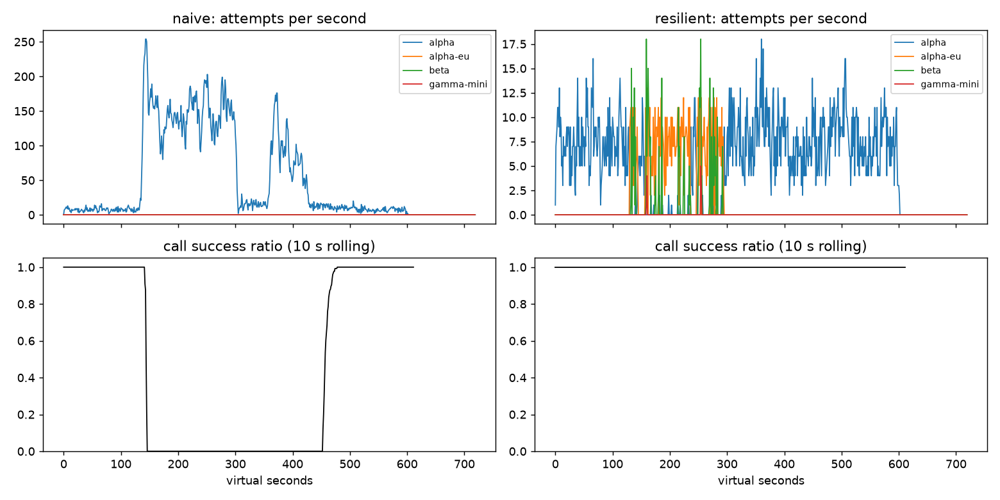

# Lab 25B — Report

**Họ tên / nhóm:** Vũ Đức Minh - 2A202602895 **Commit:**  **Điểm tự động (`make grade`):** 84.0 / 88

> Số liệu được lấy từ `reports/gameday/*.json`, `reports/workflows.json`, `reports/slo.json` và `reports/cache/*.json`. Grader cục bộ không có bộ SLO ẩn của giảng viên; phần 4 điểm đó được chấm riêng.

## 1. Kết quả Game Day (naive vs của bạn)

| Băng | Client | availability | p95 (s) | amplification | retry_ratio | cost/turn | recovery (s) | PASS? |
|---|---|---:|---:|---:|---:|---:|---:|:---:|
| G1 | naive | 0.7194 | 7.157 | 7.738 | 6.738 | 2.163 | 4.0 | Không |
| G1 | yours | 1.0000 | 4.780 | 1.063 | 0.001 | 2.104 | 0.0 | Có |
| G2 | naive | 0.4560 | 15.034 | 9.904 | 8.904 | 4.627 | 155.0 | Không |
| G2 | yours | 1.0000 | 10.362 | 1.037 | 0.005 | 2.112 | 0.0 | Có |
| G3 | naive | 1.0000 | 4.768 | 1.164 | 0.164 | 2.328 | 0.0 | Không |
| G3 | yours | 1.0000 | 4.621 | 1.058 | 0.030 | 2.140 | 0.0 | Có |
| G4 | naive | 1.0000 | 13.764 | 1.004 | 0.004 | 2.008 | 0.0 | Không |
| G4 | yours | 1.0000 | 5.626 | 1.014 | 0.002 | 2.072 | 0.0 | Có |
| G5 | naive | 0.3699 | 5.359 | 17.030 | 16.030 | 2.124 | — | Không |
| G5 | yours | 0.8179 | 5.477 | 1.003 | 0.002 | 2.504 | — | Có |
| G6 | naive | 0.5170 | 4.836 | 12.344 | 11.344 | 2.009 | 0.0 | Không |
| G6 | yours | 1.0000 | 5.961 | 1.055 | 0.018 | 2.196 | 0.0 | Có |

Resilient client pass đủ 6/6 băng với seed 25 và cũng pass lại trên seeds 7, 25, 42. G5 còn 413 lượt `client_error` được trả lỗi ngay; chúng không bị retry hay failover. G4 trở lại alpha sau sự cố; primary share sau restore là 100%.

## 2. Cấu hình client và lý do

| Tham số | Giá trị | Vì sao (dựa trên băng nào, số liệu nào) |
|---|---:|---|
| `attempt_timeout_s` | 8.0 | G6 đạt availability 100% và p95 5.961 s. Với 30 s, G6 chỉ đạt 94.88%, có 107 `deadline` và 15 `no_provider_available`; G4 gần như không đổi p95 (5.626 s so với 5.608 s) vì provider chậm vẫn trả lời. Tám giây cho alpha-eu hết hạn sớm để còn thử beta, đồng thời vẫn có khoảng đệm so với p95 5.626 s của G4. |
| `max_attempts_per_provider` | 2 | Cho tối đa một retry cùng provider. G2 đạt amplification 1.037; retry thêm nhiều lần không cải thiện kết quả tương xứng và tăng tải hàng đợi. |
| `backoff_base_s` / `backoff_cap_s` | 0.25 / 4.0 | Full jitter bắt đầu ngắn để không làm trễ lượt khỏe; cap 4 s tránh giữ lượt trong một provider quá lâu. G1 không vi phạm `retry-after`, amplification 1.063. |
| `retry_budget_ratio` | 0.1 | Giới hạn retry theo tỷ lệ lượt đầu. Khi breaker bị vô hiệu hóa trong thí nghiệm, budget giữ retry_ratio G3 ở 0.068; tắt budget làm tăng lên 0.158. |
| `breaker.window_size` / `min_calls` | 20 / 10 | 20 kết quả làm mượt lỗi ngẫu nhiên; đợi 10 kết quả trước khi trip để không mở breaker vì vài lỗi lẻ. G3 vẫn có availability 100%, retry_ratio 0.030. |
| `breaker.failure_rate_threshold` | 0.5 | Mở breaker khi ít nhất nửa cửa sổ lỗi, xử lý brown-out mà không trip vì một lỗi đơn lẻ. |
| `breaker.slow_call_s` / `slow_rate_threshold` | 5.0 s / 0.6 | G4 thêm 5 s vào provider alpha; coi call từ 5 s là chậm và trip khi ít nhất 60% cửa sổ chậm. G4 p95 của client còn 5.626 s, thấp hơn ngưỡng tape 10 s. |
| `breaker.open_duration_s` | 10.0 | Giảm tải provider trong lúc hồi phục rồi cho probe lại; độ ngắn này cho phép phục hồi sớm thay vì giữ provider ngoài ladder lâu. G2 recovery 0 s theo metric tape. |
| `breaker.half_open_max_probes` / `half_open_successes` | 2 / 2 | Giới hạn đồng thời hai probe và chỉ đóng breaker sau hai thành công nhanh; probe lỗi hoặc chậm sẽ mở lại breaker. |

Quyết định của `on_error`:

| Loại lỗi | Breaker | Hành động | Cooldown |
|---|---|---|---|
| `CLIENT_ERROR` (400/401/…) | release permit, không ghi lỗi sức khỏe | Give up; không retry, không failover | Không |
| `RATE_LIMITED` | release permit | Failover ngay, không retry cùng provider | Đến `now + retry_after` |
| `QUOTA_EXHAUSTED` | release permit | Failover ngay | `quota_cooldown_s` |
| `OVERLOADED`, `SERVER_ERROR`, `TIMEOUT` | ghi failure | Retry cùng provider nếu còn lượt, budget và deadline; nếu không thì failover | Breaker quyết định |

## 3. Ba thí nghiệm

1. **Retry budget là lớp phòng thủ cuối.** Đặt `breaker.min_calls=1000000000` và `max_attempts_per_provider=5` để breaker không trip. Khi budget bật, G2 có availability 99.83%, amplification 1.378, retry_ratio 0.058 và recovery 0 s; G3 retry_ratio là 0.068. Khi budget tắt (`ratio=100`, `max_tokens=1e9`, `min_per_s=1e6`), G2 amplification tăng lên 1.580, retry_ratio G3 lên 0.158 và recovery G2 thành 24 s. Breaker ngăn tải vào provider lỗi; budget chặn khuếch đại nếu breaker cấu hình sai hoặc phản ứng chậm, vì vậy hai lớp bảo vệ giải quyết hai tình huống khác nhau.

2. **`attempt_timeout_s: 30`.** Với timeout 30 s, G6 availability giảm từ 100% xuống 94.88%; give-up gồm 107 `deadline` và 15 `no_provider_available`. P95 G6 trên các lượt thành công là 5.440 s, thấp hơn 5.961 s ở timeout 8, nhưng đó là survivorship bias: các lượt treo thất bại đã biến mất khỏi tập tính p95. G4 gần như không đổi: availability 100% ở cả hai, p95 5.608 s với timeout 30 so với 5.626 s với timeout 8, vì ở G4 provider vẫn trả lời. Timeout nên nằm giữa p99 bình thường, deadline 30 s của user và thời gian cần cho một lần failover; 8 s cho G6 thời gian chuyển sang beta mà không cắt các call G4 đang chậm nhưng có phản hồi.

3. **Bỏ lọc khả năng tool trong `ladder()`.** Trên G6, bản thử nghiệm gửi 257 tool call tới model không hỗ trợ tool; availability là 89.22% và `give_up_reasons` ghi 257 `incompatible_model_output`. Với product manager: 257 lượt cần hoàn tiền đã được giao cho model không thể gọi công cụ, nên câu trả lời không thể hoàn tất hành động. Ladder có kiểm tra khả năng giữ số route sai ở 0 và G6 availability ở 100%.

## 4. Workflow hoàn tiền

| Executor | completion | crashes | duplicate refunds | duplicate emails | lost refunds | overpaid | wasted LLM / crash |
|---|---:|---:|---:|---:|---:|---:|---:|
| naive | 1.000 | 81 | 128 | 81 | 0 | 1,496,700¢ | 1.123 |
| yours | 1.000 | 66 | 0 | 0 | 0 | 0¢ | 0.303 |

Idempotency key ổn định ngăn service chạy side effect lần hai khi request được gửi lại, nhưng nếu không có checkpoint thì worker mới vẫn phải chạy lại các bước đã xong và tốn LLM. Checkpoint ghi sau khi step thành công giúp worker tiếp tục từ kết quả đã lưu; nếu chỉ có checkpoint mà thiếu idempotency, response có thể mất sau khi payment đã chạy nhưng trước khi checkpoint được ghi, khiến worker mới hoàn tiền lần nữa. Ghi checkpoint trước payment tạo cửa sổ crash khiến checkpoint nói “đã xong” trong khi tiền chưa được gửi, làm mất hoàn tiền.

## 5. Alerting & error budget

| Sự cố | Mong đợi | Naive alerter | Burn-rate alerter | Độ trễ phát hiện (phút) |
|---|---|---|---|---:|
| `checkout_bug` | page | page | page | 1 / 27 |
| `provider_outage` | page | page | page | 0 / 4 |
| `deploy_blip` | none | page sai | none | — |
| `slow_leak` | ticket | không phát hiện | ticket | 1337 |
| `degraded_evening` | page | page | page | 214 / 291 |
| `night_spike` | none | page sai | none | — |
| `small_bump` | none | page sai | none | — |

Thứ tự độ trễ trong bảng là naive / burn-rate; các cảnh báo không mong muốn được ghi là “—”. Burn-rate pager dùng đồng thời cửa sổ dài và ngắn, nên bỏ qua blip ngắn nhưng vẫn page cho outage lớn; luật ticket bắt được slow leak mà không đánh thức on-call bằng page.

Error budget 30 ngày: đã tiêu **42.95%**, còn **57.05%**; `freeze_releases=false`, vì còn budget. `small_bump` kéo dài 20 phút ở 12% lỗi nhưng chỉ tiêu khoảng 1% budget tháng, vì vậy không đáng page lúc 11 giờ trưa. Workflow bảo đảm từng lần hoàn tiền không tạo side effect trùng; alerting phát hiện lỗi diện rộng và báo khi SLO/error budget bị đe dọa. Một lớp không thay thế được lớp kia.

## 6. Postmortem — Băng G2 với client naive (blameless)

**Tóm tắt (3 câu):** Tại t=120 s, alpha mất 75% năng lực và hàng đợi nhanh chóng chuyển các lượt mới thành 529. Client naive khuếch đại mỗi logical call thành 9.904 attempts, vi phạm `retry-after` 28,381 lần, và chỉ 45.6% trong 2,362 user turns thành công. Alpha hồi phục ở t=300 s nhưng tải retry và request còn nằm trong hàng đợi kéo dài ảnh hưởng khách hàng thêm 155 s; hệ thống chỉ đạt ngưỡng recovery tại t=455 s.

**Ảnh hưởng:** 1,285 trên 2,362 user turns thất bại; p95 của lượt thành công là 15.034 s. Provider bị giảm năng lực trong 180 s, còn khoảng ảnh hưởng khách hàng từ trigger t=120 đến recovery t=455 là 335 s. Nếu tháng có 4 user turns/s và chỉ có sự cố này, error budget ở SLO 99.5% là 51,840 lượt lỗi/tháng; 1,285 lượt lỗi tiêu khoảng **2.48%** budget đó.

**Timeline** (giây ảo — số từ `naive_G2_overload_storm_timeseries.csv`; success ratio là cửa sổ 10 giây):

| t | Sự kiện | Bằng chứng (số) |
|---:|---|---|
| 120 | Alpha bắt đầu mất 75% năng lực | 5 attempt/s; 10 giây gần nhất 90/90 call thành công trước khi backlog lan rộng |
| 160 | Retry storm đã hình thành | 161 attempt/s; 48/48 call kết thúc trong 10 giây gần nhất đều thất bại |
| 180 | Provider vẫn bị nghẽn | 138 attempt/s; 32 call kết thúc, 0 thành công trong 10 giây |
| 240 | Retry tiếp tục đẩy tải vào alpha | 105 attempt/s; 56 call kết thúc, 0 thành công trong 10 giây |
| 300 | Alpha được khôi phục | 115 attempt/s; 43 call kết thúc, 0 thành công trong 10 giây |
| 330 | Chưa hồi phục sau restore | 6 attempt/s; 27 call kết thúc, 0 thành công trong 10 giây |
| 455 | Ngưỡng recovery được đạt | 13 attempt/s; cửa sổ 30 giây bắt đầu ở đây đạt ít nhất 95% thành công; `recovery_s=155` |

**Trigger vs root cause:** Trigger là alpha mất 75% GPU trong ba phút. Root cause là retry ba tầng chồng nhau với delay cố định, không có budget hay breaker để giới hạn retry; mỗi lần client bỏ timeout, server vẫn xử lý request cũ. Lúc t=300 tải đã tích tụ thành request đang chạy và queue; retry mới tiếp tục cạnh tranh slot với các request cũ, queue wait vượt giới hạn 10 s và tạo thêm 529. Vòng lặp này giữ provider bận sau khi sự cố gốc đã hết.

**Điều gì giúp / điều gì làm tệ hơn:** Việc khôi phục GPU ở t=300 là điều kiện cần nhưng không dọn được backlog đã tích lũy. Retry synchronized và retry-after bị bỏ qua làm tải tăng tới 216 attempt/s ở một số giây; G2 ghi nhận amplification 9.904 và 28,381 vi phạm retry-after. Không có breaker để ngừng gửi request vào alpha quá tải, cũng không có retry budget để giới hạn lượng retry toàn cục.

**Action items** (cụ thể, có owner, đo được):

| # | Hành động | Loại (prevent / detect / mitigate) | Owner | Cách kiểm chứng |
|---|---|---|---|---|
| 1 | Dùng một tầng retry với full jitter, tôn trọng `retry-after` và token budget 10%. | prevent | Agent Client | CI chạy G1/G2/G3 trên 3 seed: G1 có 0 retry-after violation, G2 amplification ≤ 1.2, G3 retry_ratio ≤ 0.10. |
| 2 | Cài burn-rate page/ticket hai cửa sổ cho SLO availability. | detect | SRE | Replay toàn bộ 30 ngày: page/ticket đúng hạn và 0 false page cho blip. |
| 3 | Dùng breaker theo provider, HALF-OPEN probe giới hạn và ladder có lọc capability. | mitigate | ShopAgent Platform | G2 recovery ≤ 30 s, availability ≥ 95%; G6 incompatible routes = 0; primary share sau restore ≥ 80%. |

## 7. Một điểm yếu còn lại

G2 resilient pass các check nhưng p95 lượt thành công vẫn là 10.362 s, cao hơn mục tiêu sản phẩm 10 s nếu áp dụng mục tiêu đó ngoài tape. Spillover giữ được availability 100% và hạ cost/good turn từ 4.627 xuống 2.112 so với naive, nhưng không loại bỏ được độ trễ khi tải chuyển qua alpha-eu/beta. Bước tiếp theo là đo p99 theo provider và đặt timeout theo phần deadline còn lại; kiểm chứng đồng thời G2 p95 ≤ 10 s, G4 p95 ≤ 10 s và G6 availability ≥ 95% trên nhiều seed.

## 8. Cache (Part G)

| Client | availability | faq_availability | cache_hit_ratio | stale_served | wrong_answers | outdated_answers | cost/turn | PASS? |
|---|---:|---:|---:|---:|---:|---:|---:|:---:|
| resilient (không cache) | 0.8373 | 0.8424 | 0.000 | 0 | 0 | 0 | 1.386 | Không |
| cached (của bạn) | 0.9120 | 0.9640 | 0.652 | 156 | 0 | 3 | 0.916 | Có |

| Tham số `cache:` | Giá trị | Vì sao (số liệu nào) |
|---|---:|---|
| `similarity_threshold` | 0.95 | 0.80 tạo 166 `other_question` sai và FAQ availability 0.8651; 0.95 có 0 câu sai, hit ratio 0.652 và FAQ availability 0.964. |
| `ttl_s` | 60 | 30 s đạt 0.9634 FAQ availability nhưng hit ratio 0.591; 60 s tăng hit lên 0.652, còn outdated ở 3; 300 s làm outdated tăng lên 95. |
| `max_stale_s` | 180 | C1 outage kéo dài 120 s. Với 180 s có 156 câu stale và FAQ availability 0.964; max stale 0 làm stale_served về 0 và FAQ availability tụt còn 0.8733. |

1. **Ngưỡng.** Với TTL/stale window giữ nguyên ở 60/180 s, ngưỡng 0.80 cho hit ratio 0.659 nhưng có 166 câu sai (`other_question`), FAQ availability 0.8651 và cost/turn 0.975. Những câu gần nghĩa nhưng khác ý định gồm “chính sách hoàn tiền” / “bao lâu nhận tiền hoàn”, “đổi size” / “đổi màu”, và phí ship nội thành / ngoại tỉnh; embedding centroid của các intent gần nhau khoảng 0.86. Ở ngưỡng hiện tại 0.95, hit ratio 0.652, sai 0, outdated 3, cost/turn 0.916; 0.97 cũng không có câu sai nhưng hit ratio giảm còn 0.578. Chọn 0.95 để giữ hit cao hơn 0.97 trong khi không trộn intent trên catalog này.

2. **TTL.** Ở TTL 30 / 60 / 300 s, hit ratio lần lượt là 0.591 / 0.652 / 0.731 và outdated answers là 2 / 3 / 95; FAQ availability tương ứng là 0.9634 / 0.9640 / 0.9640. Webhook ở t=150 chỉ báo `policy/refund`; `policy/shipping` thay đổi ở t=480 mà không báo, vì vậy webhook không thể invalidate câu trả lời ship cũ. TTL giới hạn thời gian một entry được xem là fresh và là lớp bảo vệ cho thay đổi im lặng này.

3. **Stale-if-error.** Khi `max_stale_s=0`, FAQ availability còn 0.8733 và không có stale answer nào được phục vụ. Với cửa sổ 180 s, FAQ availability tăng lên 0.9640 và có 156 stale answers trong outage. Stale chỉ được dùng sau khi provider give up; câu hỏi cá nhân vẫn đi provider và không được trả lời từ cache.

- Câu hỏi cá nhân như “Đơn #48213 của tôi đang ở đâu?” không được cache kể cả khi phân vùng theo user: trạng thái đơn hàng thay đổi nhanh, là dữ liệu riêng tư, và chỉ dựa vào user id không chứng minh quyền truy cập hay đảm bảo dữ liệu chưa lỗi thời. Chỉ FAQ dùng chung, không phụ thuộc dữ liệu tài khoản, nằm trong allowlist.
- Nếu cache giữ dashboard availability xanh trong lúc origin provider sập, on-call vẫn cần cảnh báo theo provider error/availability, `give_up_reasons`, tỷ lệ và tuổi của stale serves, cùng cache-hit ratio. Không dùng riêng availability sau cache làm tín hiệu sức khỏe provider.
